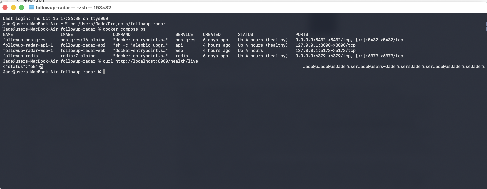
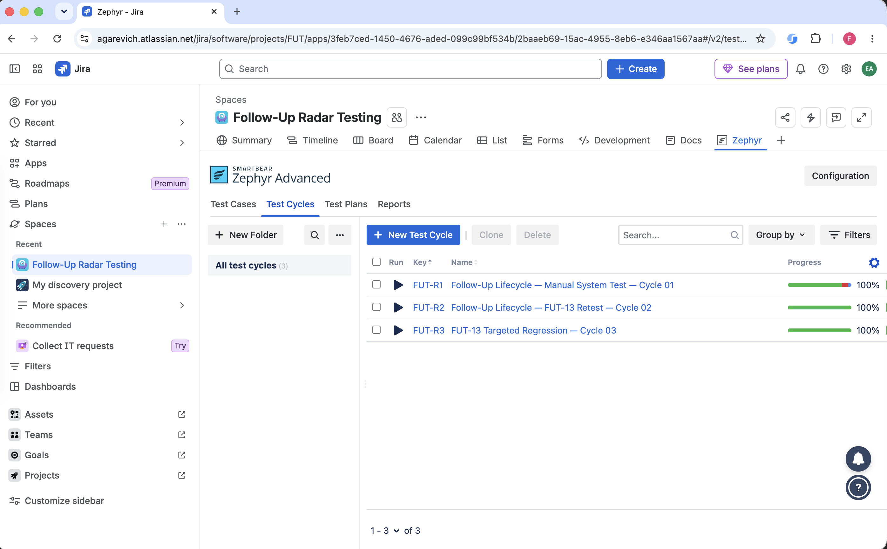
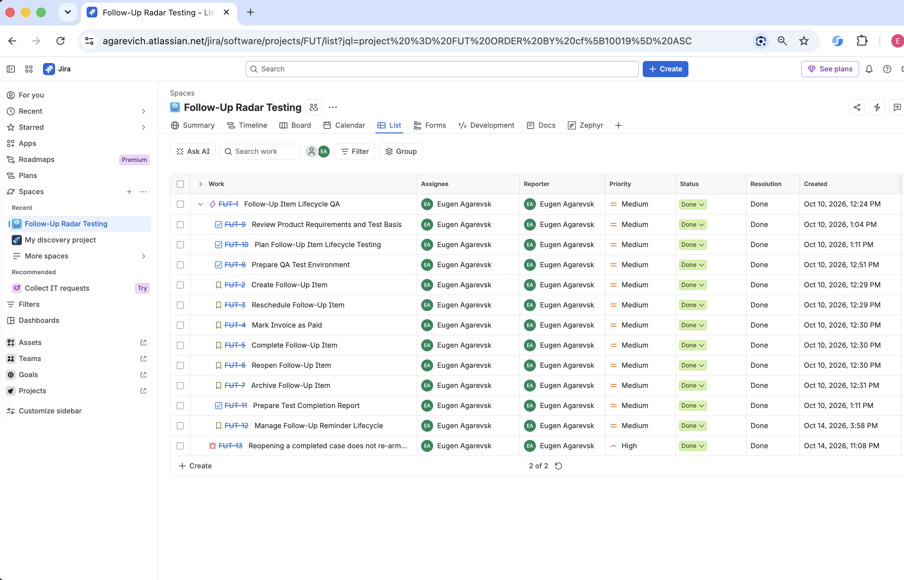
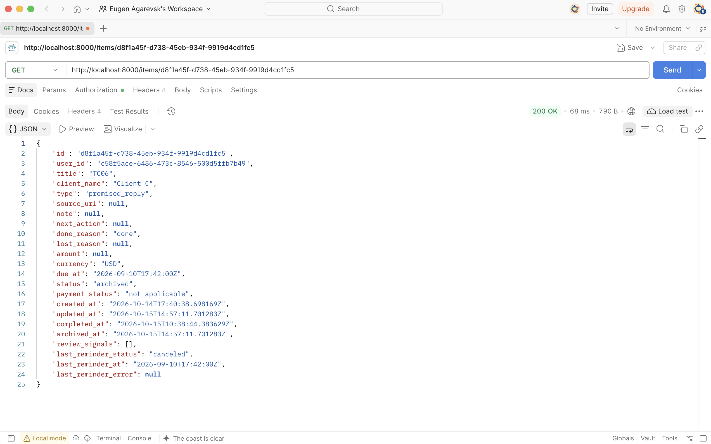

# Visual Execution Evidence — Follow-Up Item Lifecycle

Selected screenshots from the completed manual QA cycle. Each image supports a different part of the QA workflow; the live Jira and Zephyr records remain the operational source of truth.

## Docker — Local QA Environment

Local Docker Compose QA environment with PostgreSQL, API, web and Redis services running. The backend health endpoint returns a successful status.

## Zephyr Advanced — Manual Test Repository

Zephyr Advanced test repository containing 20 approved manual test cases organized by Follow-Up Item lifecycle area.

## Jira — QA Work Tracking

Jira board used to track the Follow-Up Item Lifecycle QA scope through completion, including lifecycle work, test completion activity and the closed FUT-13 defect.

## Postman — Manual API Verification

Manual API verification in Postman. The response exposes lifecycle, payment, completion and reminder state used as supporting evidence during system testing.

## Evidence Context

These screenshots complement the repository artifacts rather than replace them:

- detailed test execution results are preserved in the [Zephyr execution export](../exports/zephyr-execution-results.md);
- the FUT-13 defect lifecycle is preserved in the [Jira defect export](../exports/jira-fut-13-defect.md);
- the complete execution outcome is summarized in the [Test Execution Summary](../test-execution-summary.md);
- final QA conclusions and residual risk are recorded in the [Test Completion Report](../../05-completion/test-completion-report.md).
